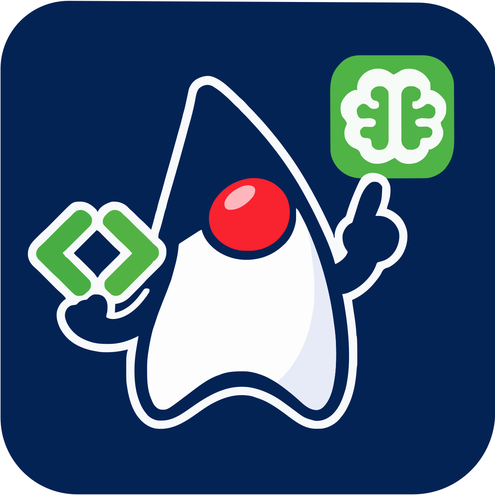
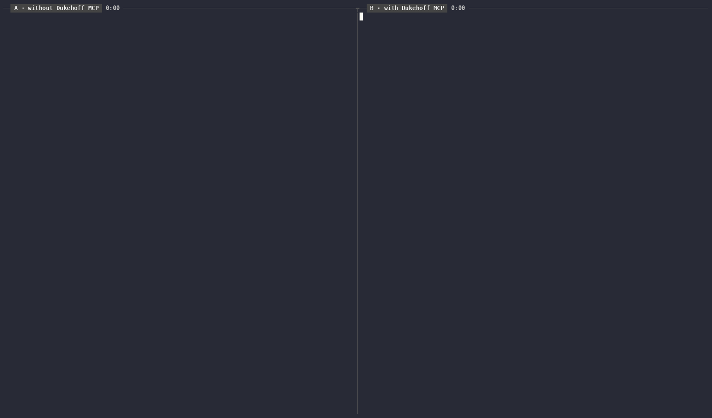

<!--

    Copyright 2026 Dukehoff GmbH
    SPDX-License-Identifier: Apache-2.0

-->
<p align="center"></p>

# Dukehoff MCP for Java

Headless [Model Context Protocol](https://modelcontextprotocol.io) server that gives coding agents
semantic access to Java code: the parser, index and refactoring engine of Apache NetBeans, which
runs headless underneath. Its technical name, used for the launcher, the artifacts and the data
directory, is `dukehoff-mcp`; agents see its tools under the server name `java`.



**Same model, same task, at the same time:** Claude Opus 5.5 renames one overload of
`ClassUtils.getShortClassName` in Apache Commons Lang, leaving the other overloads and a same-named
method of another class alone. Without the server (left) it searches with grep, edits with sed and
compiles with Maven; with it (right) it makes one `rename` call, which also checks that everything
still compiles. Both results are correct. In three runs this took 0:46–1:07 without and 0:18–0:25 with
the server; shown is the run with the middle time without it. Pauses are shortened in the video, the
times in the headers are real. [Task and check](eval/oss-tasks/03-rename-overload),
[recording script](eval/record.sh).

## Tools

| Tool | What it does |
|---|---|
| `find_symbol` | Types declared in the workspace by prefix, glob or partially qualified name, or members of them; with `include_libraries` also the JDK and the dependencies |
| `find_usages` | Semantic references to a type, method, constructor or field (`WhereUsedQuery`); grouped by file, or with `group_by: "caller"` by the method, constructor or field that contains them, named by signature |
| `find_implementations` | Subtypes of a type (all or direct) or overriding methods of a method; for a method also what it overrides or implements upwards, library declarations included |
| `outline` | Members of a type or file: modifiers, canonical signatures, declared types, line numbers; for types of the JDK and the dependencies their public API (overloads, generics, deprecations) from the class files |
| `diagnostics` | Compile errors (optionally warnings) of given files or the whole workspace, without a build |
| `rename` | Renames a type, method or field with the refactoring engine; writes to disk, returns a unified diff and, since strings stay unchanged as in the IDE, the string literals that still contain the old name (reflection, names used as data) |
| `move` | Moves a top-level class to another package, updating package declaration, imports and references |
| `change_signature` | Adds, removes, reorders, renames or retypes parameters, or changes name, return type or visibility of a method; updates callers and overriders |
| `safe_delete` | Deletes a type or member only if it is unused; otherwise lists the blocking usages |
| `inline` | Inlines a method or constant into all usages and removes it |
| `apply_rule` | Structural search, or search and replace with a NetBeans declarative hint rule (Jackpot) across the workspace; dry run and path scope supported. Tested rule packs instead of a rule: `junit5` (JUnit 4 to 5: assertions with the message moved last, `assertThat` to Hamcrest, annotations) `modernize` (try-with-resources, for-each, `getOrDefault`, `isEmpty`, `valueOf`) and `jakarta` (javax to jakarta for Servlet, JSP, EL, Persistence, Validation, Annotation, Inject, CDI, EJB, JAX-RS, Transaction, JAXB, Activation, Mail, JSON-P, JSON-B, JMS, Faces, WebSocket; the JDK's own javax packages and JCache stay); the result lists what is left for hand edits |
| `debug` | Runs a JUnit test under the debugger (Maven, Gradle, or a NetBeans module through Ant) and stops once: at a method, a line or a thrown exception, optionally only where a condition holds. Returns where it stopped, the project's stack, the local variables of the top frames and the values of given expressions; the test JVM ends afterwards |
| `workspace_status` | Opened projects, source roots, indexing state |

All refactoring tools write their changes to disk and return warnings plus a unified diff (`git diff`
format). Fatal problems stop them before anything changes. Afterwards they check for compile errors
the change introduced, also in files it did not touch, and report only those: making Apache Commons
Lang's `ArrayUtils.isEmpty(Object[])` private with `change_signature` changes one file and reports the
14 new compile errors in callers it did not touch, such as `StringUtils` (47 s for the whole call).

They write only inside the workspace (in an IDE: the open projects), like an agent harness that treats
everything outside the session's folder as external. A refactoring that would also change a file
outside (a source folder of the build that lies elsewhere, for example) changes nothing and names those
files; the agent is told to ask the user and then call again with `allow_outside` (files or folders).
Folders that may always be changed are set per registration with `--allow-writes <folder,...>`
(relative to the workspace), in VS Code with the setting `dukehoffMcp.allowedWritePaths`.

Symbols are addressed by name, not by cursor position:

```
com.acme.Foo                    com.acme.Foo.Inner  /  com.acme.Foo$Inner
com.acme.Foo#count              com.acme.Foo#bar(String,int)
com.acme.Foo#<init>()           com.acme.Foo#Foo(String)
```

## Installation

Requirements on the target machine:

* **Windows, macOS or Linux.** On Windows the server is started with `java -jar bin\dukehoff-mcp.jar`
  (`bin/dukehoff-mcp`, a bash script, does the same on macOS and Linux). CI runs the end-to-end
  smoke test on all three.
* **A JDK 17 or newer**, a full JDK with `javac` (a JRE is not enough). `dukehoff-mcp` takes `--jdk`,
  `$DUKEHOFF_MCP_JDK`, `$JAVA_HOME`, the `java` on the `PATH` or (macOS) `/usr/libexec/java_home`, in
  this order. Use a JDK at least as new as the Java version of your projects: NetBeans compiles
  them against that JDK's class library unless a project names another platform.
* For Maven and Gradle projects the usual access to their dependencies (see Troubleshooting).

Working in VS Code or NetBeans? Then you need no archive: the
[VS Code extension](#vs-code-github-copilot-agent-mode) or the
[NetBeans plugin](#with-a-running-netbeans-ide) brings the server along.

Download the archive of the latest release from the
[Releases page](https://github.com/dukehoff-gmbh/dukehoff-mcp/releases): `dukehoff-mcp-<version>.tar.gz`
for macOS and Linux, `dukehoff-mcp-<version>.zip` for Windows (`SHA256SUMS` has their checksums;
building it yourself: see Building). Unpack it anywhere, for example to `/opt` or `C:\tools`:

```sh
tar xzf dukehoff-mcp-<version>.tar.gz -C /opt      # creates /opt/dukehoffmcp, about 270 MB
/opt/dukehoffmcp/bin/dukehoff-mcp --version
/opt/dukehoffmcp/bin/dukehoff-mcp --check /path/to/project   # which JDK, data directory and workspace would be used
```

On Windows, unpack `dukehoff-mcp-<version>.zip` (Explorer, or `tar -xf dukehoff-mcp-<version>.zip -C C:\tools`), then:

```bat
java -jar C:\tools\dukehoffmcp\bin\dukehoff-mcp.jar --version
java -jar C:\tools\dukehoffmcp\bin\dukehoff-mcp.jar --check C:\path\to\project
```

The indexes are kept in `%LOCALAPPDATA%\dukehoff-mcp` on Windows and `~/.cache/dukehoff-mcp` elsewhere.

For a team, unpack it to the **same path on every machine**: then a project's `.mcp.json` or
`.vscode/mcp.json` can be committed and works for everyone. To update, replace the folder; the
indexes under `~/.cache/dukehoff-mcp` stay and are checked on the next start. To remove dukehoff-mcp, delete the
folder and `~/.cache/dukehoff-mcp`.

## Registering with your agent

The agent starts the launcher itself and talks to it over stdin/stdout; the launcher connects to the
workspace's server (see What to expect). Let the launcher print the configuration with its own
absolute path:

```sh
/opt/dukehoffmcp/bin/dukehoff-mcp --config claude                      # also: copilot, vscode, cursor, codex, omp
java -jar C:\tools\dukehoffmcp\bin\dukehoff-mcp.jar --config vscode    # Windows: java.exe -jar dukehoff-mcp.jar
```

On Windows, register `java.exe` with `-jar ...\dukehoff-mcp.jar` as `--config` prints it, not `dukehoff-mcp.cmd`:
clients start `.cmd` files through `cmd /c`, which breaks paths with spaces. The JDK `--config`
names is the one that ran it; `java -jar` works with any Java 17+ on the PATH.

### Claude Code

```sh
claude mcp add --scope user java -- /opt/dukehoffmcp/bin/dukehoff-mcp
```

or, shared with the team, `.mcp.json` in the project:

```json
{ "mcpServers": { "java": { "command": "/opt/dukehoffmcp/bin/dukehoff-mcp", "args": [] } } }
```

The first start indexes the project, and a refactoring right after a start waits for the index
check, so allow time: `MCP_TIMEOUT=120000 MCP_TOOL_TIMEOUT=600000` (shell profile, or `"env"` in
`~/.claude/settings.json`).

### VS Code (GitHub Copilot agent mode)

The easiest way is the extension **Dukehoff MCP for Java** from the
[VS Code Marketplace](https://marketplace.visualstudio.com/items?itemName=dukehoff.dukehoff-mcp-java)
(Extensions view, search "Dukehoff MCP"; or `code --install-extension dukehoff.dukehoff-mcp-java`).
Each release also carries it as `dukehoff-mcp-java-<version>.vsix` on the
[Releases page](https://github.com/dukehoff-gmbh/dukehoff-mcp/releases) ("..." menu of the Extensions
view, "Install from VSIX..."). It needs no download of the runtime above: it brings the Apache NetBeans
Language Server extension along and runs inside its NetBeans; the tools appear in Copilot's agent mode
as the server **Java**. It needs NetBeans' Java support enabled (`netbeans.javaSupport.enabled`, the
default). Claude Code's VS Code extension has its own MCP configuration and does not see that server;
the command **Dukehoff MCP: Use the Java tools in Claude Code** registers it there for the folder.

Refactorings write their files themselves, apart from the agent's own edits. The extension shows each
one in a notification with **Review** (a diff of all files it changed) and **Undo**; the setting
`dukehoffMcp.refactoringReview` chooses `notify` (default), `openDiff` (open the diff right away) or
`off`.

With the standalone runtime instead: `.vscode/mcp.json` in the project (or the user configuration,
command palette "MCP: Open User Configuration", for all projects):

```json
{ "servers": { "java": { "type": "stdio", "command": "/opt/dukehoffmcp/bin/dukehoff-mcp", "args": ["${workspaceFolder}"] } } }
```

Windows:

```json
{ "servers": { "java": { "type": "stdio",
    "command": "C:\\Program Files\\Eclipse Adoptium\\jdk-21\\bin\\java.exe",
    "args": ["-jar", "C:\\tools\\dukehoffmcp\\bin\\dukehoff-mcp.jar", "${workspaceFolder}"] } } }
```

Then start the server from the MCP view or `mcp.json` ("Start"), and use Copilot Chat in agent mode;
the tools appear under the `java` server.

### GitHub Copilot CLI

`~/.copilot/mcp-config.json` (Windows: `%USERPROFILE%\.copilot\mcp-config.json`); merge it into the
file if it exists. `"tools": ["*"]` is required and enables all tools:

```json
{ "mcpServers": { "java": { "type": "local", "command": "/opt/dukehoffmcp/bin/dukehoff-mcp", "args": [], "tools": ["*"] } } }
```

Windows:

```json
{ "mcpServers": { "java": { "type": "local",
    "command": "C:\\Program Files\\Eclipse Adoptium\\jdk-21\\bin\\java.exe",
    "args": ["-jar", "C:\\tools\\dukehoffmcp\\bin\\dukehoff-mcp.jar"], "tools": ["*"] } } }
```

Or interactively: `/mcp add` in a Copilot CLI session, with the command and arguments above. Start
`copilot` in the project directory: the server works on the directory it is started in. `/mcp show`
lists the server and its tools.

### Codex CLI

`~/.codex/config.toml`:

```toml
[mcp_servers.java]
command = "/opt/dukehoffmcp/bin/dukehoff-mcp"
args = []
startup_timeout_sec = 120
```

### Cursor, omp (Oh My Pi)

`.cursor/mcp.json` or `.omp/mcp.json` in the project (omp also reads `.mcp.json`, `.cursor/` and
`.vscode/` files):

```json
{ "mcpServers": { "java": { "command": "/opt/dukehoffmcp/bin/dukehoff-mcp", "args": [] } } }
```

Clients start the server in the project directory, so no workspace argument is needed; give one
(`dukehoff-mcp /path/to/project`) if your client starts servers elsewhere. A workspace can be one project
or a folder of projects (Maven, Gradle, Ant).

### With a running NetBeans IDE

If you work in NetBeans, an agent in a terminal can use the running IDE instead of a NetBeans of its
own: the same index, the projects you have open, and the refactorings show in the editor at once.
This needs no runtime archive:

1. Install the plugin: download `dukehoff-mcp-netbeans-<version>.nbm` from the
   [Releases page](https://github.com/dukehoff-gmbh/dukehoff-mcp/releases), then in NetBeans 31 or
   newer Tools > Plugins > Downloaded > Add Plugins..., Install, and restart if asked.
   The IDE then starts the server by itself.
2. Download `dukehoff-mcp-launcher-<version>.jar` from the same release and let it print the
   registration with `--ide`, e.g. `java -jar dukehoff-mcp-launcher-<version>.jar --config claude --ide`.
3. Open the project in NetBeans, then start the agent in its folder.

With the runtime installed, `dukehoff-mcp --config claude --ide` does the same. The agent's folder (where it was started) is its workspace: the
tools see the projects open in NetBeans there, name files relative to it and write only inside it. If
no project there is open, the tools say so; open it in NetBeans. NetBeans announces the server in
`~/.dukehoff-mcp/ide/`; `-J-Ddukehoffmcp.ide.server=false` (in `etc/netbeans.conf`) turns it off.

**An agent in a sandbox** needs no network port: only Java, the launcher jar and read access to
`~/.dukehoff-mcp/ide/`, where the server's Unix domain socket lies next to its announcement (in a
temporary folder instead if that path is longer than about 100 bytes), and the project at the same
path as in NetBeans. A separate process namespace is fine. For [lince](https://github.com/RisorseArtificiali/lince),
for example: `home_ro_dirs = [".dukehoff-mcp"]` under `[sandbox]`. The refactorings are done by NetBeans
itself, outside the sandbox; they write only inside the agent's folder unless more is allowed (see above).

### Telling the agent when to use the tools

Agents pick tools by what they read, and project instructions weigh most. A short section in the
project's `CLAUDE.md` (Claude Code) or `AGENTS.md` (Copilot, Codex, Cursor and others) makes them use
the tools where they pay. In our evaluation, with this section in `CLAUDE.md`, Claude Code used
`apply_rule` for a modernization on its own in 3 of 3 sessions (0 of 3 without), with a third fewer
turns; the VS Code extension offers to add it (command "Add Java tool hints to AGENTS.md").

```markdown
## Java code

These hints apply when the Java MCP tools (server `java`) are connected; without them, ignore this section.
To rename, move or delete Java code or change a method's signature, use the Java MCP tools
(`rename`, `move`, `change_signature`, `safe_delete`) instead of editing files: one call updates
every reference, also in other modules, and checks that everything still compiles.
To find who calls or uses a method, field or class, use `find_usages` (`group_by: "caller"` names the
calling methods).
For the same kind of change at many places (migrations, modernizations, replacing an API), use
`apply_rule`: structural rewrite rules that check types and match whole statements, not text.
For JUnit 4 to 5, javax to jakarta or a Java modernization, start with `apply_rule` and
`pack: "junit5"`, `"jakarta"` or `"modernize"` (a dry run first), then finish what the result lists by hand.
Before calling a method of the JDK or a dependency whose exact signature you are unsure of, look it
up with `outline`.
```

Its first line makes the section safe to commit for a team: agents of colleagues without the server
skip it. To keep it to yourself instead, put it where only your agent reads it; these files apply to
all your projects, which the first line covers as well:

| Client | Personal instructions |
|---|---|
| Claude Code | `~/.claude/CLAUDE.md`; it keeps the project's `AGENTS.md` loading. (A `CLAUDE.local.md` in the project would stop Claude Code from reading `AGENTS.md` unless it imports it with `@AGENTS.md`.) |
| Codex CLI | `~/.codex/AGENTS.md` |
| GitHub Copilot CLI | `~/.copilot/copilot-instructions.md` |
| VS Code with Copilot | an instructions file in your user profile (command "Chat: New Instructions File", location "User Data") |
| Cursor | User Rules in Cursor's settings |

### Choosing the tools

Clients limit the number of tools, and every tool description costs context in each session. A
registration can offer a subset with `--tools`: tool names, groups and presets, comma separated.
`--config` puts the selection into the printed configuration:

```sh
dukehoff-mcp --config copilot --tools copilot          # the core group: diagnostics, find_usages, outline, rename
dukehoff-mcp --config claude --tools core,refactor     # plus change_signature, move, safe_delete, inline
```

| Group | Tools |
|---|---|
| `core` | diagnostics, find_usages, outline, rename |
| `refactor` | change_signature, move, safe_delete, inline, find_usages, diagnostics |
| `migrate` | apply_rule |
| `debug` | debug |
| `all` | every tool (the default) |

Presets: `copilot` (= `core`), `claude-code` (= `all`). Several registrations with different
selections (e.g. one per client) share the workspace's server and index. The server's instructions
and hints name only the tools a registration offers. To change the selection, edit the registration's
`args` and restart the session; nothing needs reinstalling.

## What to expect

* **First start in a workspace:** NetBeans indexes the JDK and the project and resolves Maven
  dependencies: about 50 s for Apache Commons Lang (500 files), minutes for large projects. A tool
  call waits up to 150 s for it, then reports "not ready" and asks the agent to call again (indexing
  goes on meanwhile); `workspace_status` shows the progress. The limit stays below the clients'
  request timeouts (Copilot CLI: 3 minutes); for a client with a shorter one, pass e.g.
  `-- -J-Ddukehoffmcp.wait.seconds=50` to the launcher.
* **The server keeps running between sessions:** one per workspace, shared by all sessions on it
  (also several at once, and when Copilot CLI switches sessions). A new session's first answer comes
  from the running server: 2.4 s for a `find_usages` on Commons Lang, against 10 s when NetBeans has
  to start and check its index. NetBeans watches the files meanwhile, so the index stays current.
  Refactorings of different sessions run one after the other. An idle server holds about 1.5–2 GB of
  memory; it stops after 30 minutes without a session (`-- -J-Ddukehoffmcp.idle.minutes=<n>`), when the
  workspace folder is deleted, or with `dukehoff-mcp --stop <workspace>`; `--check` shows whether one runs.
  After an update the next session replaces a server of the old version. `--no-daemon` runs a
  server only for one session (as before; also what a NetBeans installation with the module does).
* **After a restart of the server** it reuses the index and only checks it for changes: 3 s for
  Commons Lang, about 100 s for very large code bases (NetBeans' own 1,100 source roots). Tool calls
  wait for the check.
* Every workspace has its own NetBeans userdir and index under `~/.cache/dukehoff-mcp`
  (`--data` / `$DUKEHOFF_MCP_DATA`). Other NetBeans instances, including a running IDE, are not affected.
* Compiler messages are English (`--locale` to change).

## Troubleshooting

* **Logs:** stderr of the server (your agent usually shows it) and
  `~/.cache/dukehoff-mcp/<workspace>-<id>/userdir/var/log/messages.log`, on Windows
  `%LOCALAPPDATA%\dukehoff-mcp\<workspace>-<id>\userdir\var\log\messages.log` (usually
  `C:\Users\<you>\AppData\Local\...`; `--check <workspace>` prints the directory). The persistent
  server's own output goes to `daemon.log` in that directory. Each start rotates
  the log; the previous two are `messages.log.1` and `.2`. Every tool call logs its duration
  (`dukehoff-mcp call:`), a wait for the index longer than a second its phases (`dukehoff-mcp wait:`), and a call
  still running after 30 s its stack, the first one also all threads (`dukehoff-mcp slow call:`): send these
  lines when a client reports a timeout.
* **Two sessions on one workspace without the persistent server** (`--no-daemon`, or a NetBeans
  installation): each gets its own NetBeans; the second uses the data directory `<workspace>-<id>-2`
  (then `-3`, ...), which indexes once on its first use and then needs about as much memory as the
  first. The same happens when a server for one session already runs where a persistent one would go.
* **"not ready" or timeouts on the first start:** indexing is still running; raise the client's
  startup timeout (see above) and call again. A call that times out in the client although the log
  shows `dukehoff-mcp call: ... ms` for it means the answer did not reach the client: check that only one
  `dukehoff-mcp timing: initialize` line per log carries the same JVM start time.
* **Compile errors that `mvn` does not show** (`diagnostics`): the dependencies could not be
  resolved. NetBeans' Maven reads `~/.m2/settings.xml` (on Windows `%USERPROFILE%\.m2\settings.xml`)
  like `mvn` does, so an Artifactory or Nexus mirror, proxies and credentials configured there apply;
  running `mvn dependency:go-offline` once in the project fills the local repository. Gradle
  projects use Gradle's own configuration (`~/.gradle/gradle.properties`, init scripts, the
  project's wrapper).
* **Wrong JDK:** `--check` shows which one is used; set `$DUKEHOFF_MCP_JDK` or pass `--jdk`.
* **macOS, archive downloaded with a browser:** if Gatekeeper blocks the bundled native libraries,
  remove the quarantine flag: `xattr -dr com.apple.quarantine /opt/dukehoffmcp`.

## Building

Needs a JDK 17+ and Maven 3.9:

```sh
mvn clean package    # runtime/target/dukehoff-mcp-<version>.tar.gz and .zip (and the module, server/target/*.nbm)
tests/smoke/smoke.sh runtime/target/dukehoffmcp/bin/dukehoff-mcp          # end-to-end test, exit 0 = pass
python3 tests/smoke/project-types.py runtime/target/dukehoffmcp/bin/dukehoff-mcp   # Maven, Gradle, Ant
```

The runtime is a headless NetBeans built from the NetBeans clusters on Maven Central (release set in
`pom.xml`, `netbeans.version`, currently NetBeans 31), without the modules a headless server does
not need, plus the module of this repository. It ships `LICENSE`, `NOTICE` and the license texts of
everything bundled; see [runtime/LICENSING.md](runtime/LICENSING.md). The module uses public NetBeans
APIs only and also runs in a NetBeans 31 installation (unpack the NBM's `netbeans/` folder into the
`java/` cluster and copy `launcher/dukehoff-mcp` to `java/bin/`).

### Without the launcher

```sh
mkdir -p <userdir>/var && touch <userdir>/var/imported
/opt/dukehoffmcp/bin/dukehoffmcp --nogui --nosplash \
    -J-Djava.awt.headless=true -J-Duser.language=en -J-Duser.country=US \
    --jdkhome /path/to/jdk-17+ --userdir <userdir> --cachedir <cachedir> \
    --start-mcp-server --mcp-workspace /path/to/project
```

* Use a dedicated userdir per workspace. With a userdir that is already in use, the launcher
  forwards the command line to the running instance instead of starting a new one.
* Without `<userdir>/var/imported`, a fresh userdir offers to import the settings of an installed
  NetBeans; the dialog fails headless and NetBeans exits before the server starts.
* stdout carries the protocol only.

## Evaluation

`eval/run.sh` measures whether the server helps: it runs four tasks with Claude Code in headless
mode, once with only its built-in tools and once with this server added, each on a fresh copy of a
generated two-module project full of traps for text search (overloads, same-named methods of
unrelated classes, names in comments and strings, `String` next to `StringBuilder`):

| Task | Checked by |
|---|---|
| 01 find the callers of one overload | exact `path:line` list, no source changes |
| 02 rename a method across modules | compiles, only the right `apply` renamed |
| 03 remove a deprecated method, migrate callers | compiles, tests pass, no call left |
| 04 `String.length() == 0` to `isEmpty()` | compiles, `StringBuilder`, arrays and collections untouched |

It records correctness, turns, tokens, cost, time and the tools the agent called per run (the
session transcripts are kept as stream-json; `--reps N` for repetitions) and prints a Markdown
summary. Results so far: [eval/RESULTS.md](eval/RESULTS.md). **Every run is a real Claude Code session
on your login and costs tokens.** The checks were validated by solving all tasks with the server's
own tools. `eval/nb-tasks` has three tasks for the `java/` folder of an Apache NetBeans checkout
(`run.sh --repo <checkout> --workspace java --tasks-dir eval/nb-tasks --dukehoff-mcp <launcher>`); their
expected answers fit apache/netbeans at commit `c080a039d`.

`eval/record.sh` records a task as a side-by-side terminal video, without and with the server (usage in the script).

## Design notes

* The protocol layer (`McpServer`) is a small JSON-RPC-over-stdio implementation on top of
  json_simple, so the module needs no new external libraries. Only the tools capability is
  implemented. If more of the protocol is needed it can be replaced by the official MCP Java SDK
  without touching the tools.
* Projects are opened like the Java LSP server does it: priming build, contained projects,
  `OpenProjects`, then waiting for the initial scan.
* Before every tool call the workspace folder is refreshed and pending scans are awaited, so
  edits the agent made on disk are reflected in the results.
* The module depends on public NetBeans APIs only (no friend or implementation dependencies), all
  taken from Maven Central.

## Contributing

Contributions are welcome; see [CONTRIBUTING.md](CONTRIBUTING.md) for building, testing and the
contributor license agreement.

## How this code is written

dukehoff-mcp is developed with AI assistance: most of the code, tests and documentation are written by
Claude (Anthropic) in Claude Code, directed, reviewed and tested by the maintainers. Commits made
that way carry a `Co-Authored-By: Claude` trailer. The evaluation in `eval/` is how we check that
the tools actually help agents, and the smoke tests run every tool end to end.

## License

dukehoff-mcp is licensed under the [Apache License, Version 2.0](LICENSE). Copyright 2026 Dukehoff GmbH.

It runs on [Apache NetBeans](https://netbeans.apache.org/), which is licensed under the Apache
License 2.0 as well; dukehoff-mcp is not part of, nor endorsed by, the Apache NetBeans project or the
Apache Software Foundation. "Apache", "NetBeans" and "Apache NetBeans" are trademarks of the Apache
Software Foundation. The runtime distribution bundles NetBeans and third-party components under
their own licenses; see [runtime/LICENSING.md](runtime/LICENSING.md) and `runtime/src/main/licenses`.
